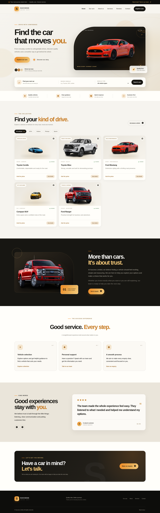
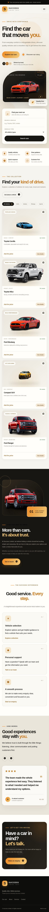

# Success Limited — Car Website Redesign

A modern, responsive front-end redesign of the original Car Dealer project, built to deliver a cleaner visual experience, improved usability, and interactive vehicle browsing.

##  Overview

Success Limited is a car dealership website concept featuring a modern interface for exploring vehicles, searching available listings, managing favourites, and making vehicle enquiries.

The project focuses on responsive design, interactive functionality, smooth animations, and an engaging user experience across different screen sizes.

## Main Features

- Responsive navigation for desktop and mobile devices.
- Vehicle search by name.
- Vehicle category filtering.
- Interactive favourite button states.
- Vehicle enquiry modal with email integration.
- Testimonial slider.
- Scroll  animations that replay as sections leave and re-enter the viewport.
- Reduced-motion accessibility support.

## 🛠️ Technologies Used

- HTML5
- CSS3
- JavaScript
- Animate.css


##  Live Demo

[View Success Limited]((https://successspirite.github.io/Car-dealer/))


##  Screenshots

### Desktop Preview


### Mobile Preview


##  Project Structure

```text
Car-dealer/
│
├── index.html
├── style.css
├── app.js
│
├── img/
│
└── README.md
```

## 🚀 Run Locally

No build tools or package installation are required.

1. Clone the repository:

   ```bash
   git clone https://github.com/successSpirite/Car-dealer.git
   ```

2. Open the project folder.
3. Open `index.html` in your browser.

You can also use the Live Server extension in Visual Studio Code.

## 📌 Project Notes

This is a frontend demonstration project.

- Search and category filters operate on the sample vehicles included in the page.
- Vehicle enquiries open the visitor's default email application.
- A backend or enquiry service would be required for production-level enquiry management.
- Vehicle pricing and availability should be replaced with verified dealership information before commercial use.

## Developer

**Cletus Asanyo**

Frontend Developer | Web Development Enthusiast

- GitHub: [@successSpirite](https://github.com/successSpirite)
- Portfolio: [My Portfolio](https://successspirite.github.io/)
LinkedIn: [Connect with me](https://linkedin.com/in/asanyo-cletus-366817250)

---

**Designed and developed by Cletus.**
